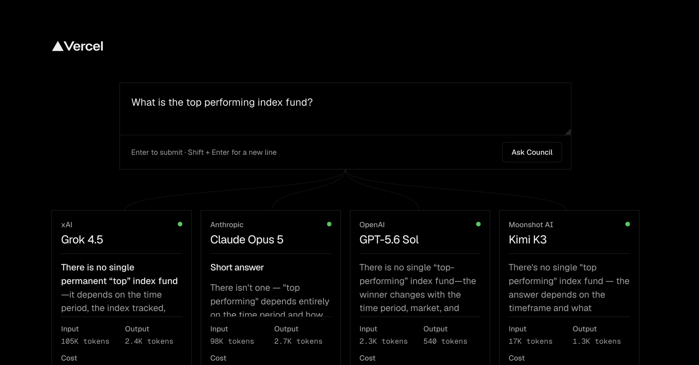

# Decision Desk

An [eve](https://eve.dev) and Next.js app that researches your website or GitHub repository, suggests the decisions your team actually faces, then sends the one you pick to four models in parallel. A judge returns the call, the main risk, a 24-hour next step, and per-model agreement scores.

The council uses:

- SpaceXAI Grok 4.7
- Anthropic Claude Opus 5.5
- OpenAI GPT-6.1 Sol
- Moonshot AI Kimi K3



## Flow

```text
website or repo → research brief + tailored decisions → four parallel recommendations → judge call, risk, next step, and agreement scores
```

### 1. Source analysis (optional)

Paste a website or a GitHub repository (`acme.com`, `github.com/owner/repo`, or `owner/repo`) and pick a depth:

| Depth        | Website                                                                    | GitHub repository                                                                                    |
| ------------ | -------------------------------------------------------------------------- | ---------------------------------------------------------------------------------------------------- |
| Surface scan | Homepage, site map, and the two highest-signal pages (pricing, about, …)   | Metadata, README, languages, latest release, top-level files                                         |
| Deep dive    | Up to 13 key pages, the full site map, and the main GitHub repo it links to | Full file tree, manifests and CI config, commits, most-discussed issues, open PRs, contributors, and the homepage |

`POST /api/analyze` streams progress as newline-delimited JSON, so the UI shows each stage, every page as it is read, and prompt labels as the analyst model drafts them. The analyst (`ANALYSIS_MODEL`, Claude Sonnet 5.5 by default) returns a profile, key facts, findings, a context brief, and 4 (surface) or 6 (deep) decisions written for that source. The suggestion pills switch to those decisions, and the brief is sent to every desk member with the question.

The current source is kept in the browser and saved with each decision in history.

### 2. The desk

The root [eve agent](https://eve.dev/docs/) delegates the prompt to four declared [subagents](https://eve.dev/docs/subagents), each with a fixed OpenRouter model in its own durable session. The client follows those child [session streams](https://eve.dev/docs/concepts/sessions-runs-and-streaming) so every response appears independently. After all four finish, the root agent returns the call and agreement scores through a [structured output schema](https://eve.dev/docs/guides/client/output-schema).

## Interface

The UI is built on the [Vercel brand system](https://vercel.com/geist/vercel-brand.css) (`--vbg-*` tokens, Geist Sans and Mono) and follows the light or dark system theme. Every control is styled to match it rather than left to the browser:

- **Flow:** source → choice → four member cards → the call, joined by connector lines, so the page reads as one pipeline.
- **Source step:** a URL field that detects website or GitHub repo as you type, a depth control built from two cards (Surface scan or Deep dive), a live stage list with spinners and checkmarks, a feed of pages as they are read, and prompt chips that appear while the analyst drafts them.
- **Suggestion pills:** hovering or focusing a pill previews the full question below the row instead of using a browser tooltip.
- **Decision field:** grows with its content up to a cap, with no resize handle.
- **Alignment scores:** custom bars that fill on reveal, amber when a member disagrees with the call.
- **Disclosures:** findings and sources open with `+` and `−` markers instead of the native triangle.
- **Scrollbars:** thin, rounded, and transparent-tracked everywhere: the page, the member cards, the decision field, and code blocks. Chromium and Firefox use `scrollbar-width` and `scrollbar-color`; Safari uses `::-webkit-scrollbar`.
- **Details:** themed text selection, caret, and autofill colors, no mobile tap highlight, visible focus rings on every control, and reduced motion respected.

## Scraping providers

Decision Desk uses the first provider that is configured:

1. **[Firecrawl](https://firecrawl.dev)** (`FIRECRAWL_API_KEY`). The free plan includes 1,000 credits a month with no card. A surface scan costs about 4 credits and a deep dive about 14 (1 per page plus 1 for the site map). Concurrency defaults to the free plan's limit of 2; raise it with `FIRECRAWL_CONCURRENCY`.
2. **[Jina Reader](https://jina.ai/reader)**, keyless by default (about 20 requests a minute), or with `JINA_API_KEY` for higher limits. Site discovery uses `robots.txt` and `sitemap.xml`.

Repositories always use the public GitHub REST API. Set `GITHUB_TOKEN` (no scopes needed) to raise the anonymous limit of 60 requests an hour; with a token, a website's linked repository also gets the deep treatment.

Alternatives considered: Exa (strong search and page contents, free monthly credit) and Context.dev (500 free credits, unified scrape and brand API). Firecrawl won on whole-site mapping plus clean markdown in one free tier.

## Main pieces

- `apps/web/app/_source/` — URL parsing, website and GitHub collectors, provider selection, and the analyst model
- `apps/web/app/api/analyze/route.ts` — streaming analysis endpoint
- `apps/web/app/source-intake.tsx` — source step: input, depth tiers, live progress, and profile
- `apps/web/app/decision-desk.tsx` — submission, child streaming, and rendering
- `agent/instructions.md` and `agent/subagents/` — judging behavior and the four desk members
- `agent/lib/schemas.ts` — recommendation, risk, next step, and score schema

## Run locally

```bash
pnpm install
cp .env.example .env.local
pnpm dev:local
```

`pnpm dev:local` starts `eve dev` and `next dev` together and proxies `/eve/*` to the agent. Set `OPENROUTER_API_KEY` in `.env.local`; the scraper keys are optional.

To run the complete Vercel service graph instead (requires `vercel link`):

```bash
pnpm dev:all
```

## Environment

| Variable                | Required | Purpose                                                                     |
| ----------------------- | -------- | --------------------------------------------------------------------------- |
| `OPENROUTER_API_KEY`    | Yes      | The four desk members, the judge, and the source analyst                    |
| `FIRECRAWL_API_KEY`     | No       | Preferred scraper; without it the keyless Jina Reader is used               |
| `FIRECRAWL_CONCURRENCY` | No       | Parallel Firecrawl requests (default 2, the free plan's limit)              |
| `JINA_API_KEY`          | No       | Higher Jina Reader rate limits                                              |
| `GITHUB_TOKEN`          | No       | 5,000 GitHub requests an hour instead of 60, and deep reads of linked repos |
| `ANALYSIS_MODEL`        | No       | OpenRouter model for source analysis (default `anthropic/claude-sonnet-5.5`) |

## Checks

```bash
pnpm typecheck
pnpm build:web
```

`pnpm build` also runs `eve build`, which needs a linked Vercel project (`vercel link` and `vercel pull`) for its sandbox templates.
